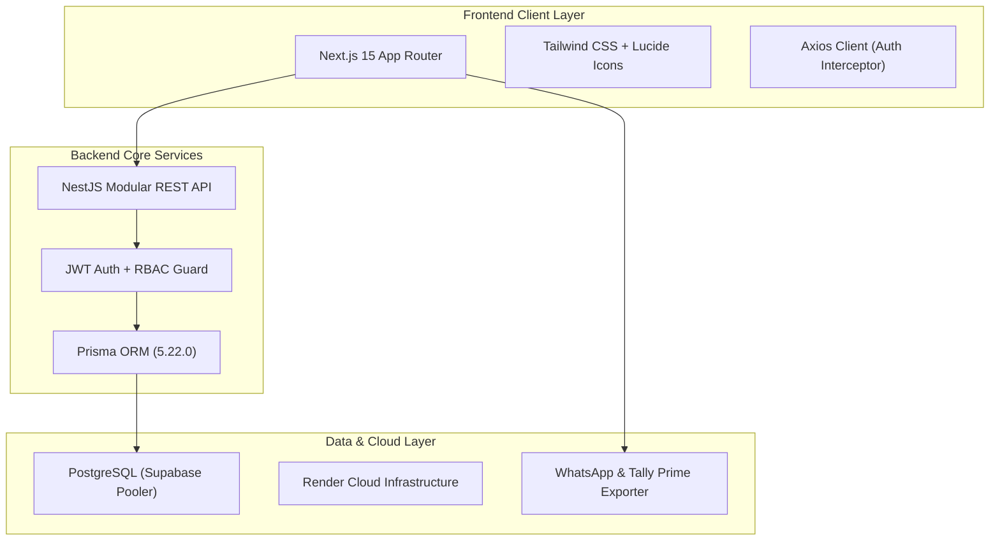

# BizFlow ERP — Comprehensive Demo Presentation & Walkthrough Guide

---

## 1. Executive Summary & Product Pitch

### What is BizFlow ERP?
**BizFlow ERP** is a modern, full-featured, multi-tenant Enterprise Resource Planning (ERP) platform purpose-built for Indian SMEs, retail chains, wholesalers, and fast-growing enterprises. It bridges the gap between traditional accounting software (like Tally) and legacy desktop billing apps (like Vyapar), offering a high-performance, cloud-native web and mobile experience.

### Key Value Propositions
- **All-in-One Business Operating System:** Consolidates POS counter sales, B2B invoicing, multi-warehouse inventory, double-entry accounting, banking, GST taxation, HR/payroll, and CRM into a unified platform.
- **Enterprise Multi-Tenancy & Multi-Branch:** Manage multiple companies (e.g., *iit labs*, *Acme Enterprises*, *ecorp*) and multiple branch locations from a single login with instant switching.
- **Indian Compliance First:** Native GST invoicing, HSN/SAC codes, CGST/SGST/IGST automatic calculations, GSTR-1 / GSTR-3B reporting, and direct Tally Prime XML export.
- **Modern Cloud Architecture:** Built with Next.js 15 (Tailwind CSS, Lucide icons), NestJS (TypeScript REST API), PostgreSQL on Supabase with Prisma ORM, and automated CI/CD deployment on Render.

---

## 2. System Architecture & Tech Stack Overview

### Technology Highlights
| Component | Technology | Role & Capability |
| :--- | :--- | :--- |
| **Web Frontend** | Next.js 15, React 19, Tailwind CSS | Responsive ERP dashboard, sub-second route transitions, dark/light aesthetics. |
| **Backend API** | NestJS, TypeScript, Node.js | Clean architecture, modular controllers & services, strict validation with Zod. |
| **Database & ORM** | PostgreSQL (Supabase), Prisma ORM | Multi-tenant schema with foreign keys, indexes, transactions, and audit timestamps. |
| **Authentication** | Argon2id, JWT (Access + Refresh) | Enterprise-grade password hashing, 7-day token persistence, role/permission checks. |
| **Deployment** | Render Blueprint (`render.yaml`) | Automated dual web service deployment (`bizflow-api` & `bizflow-web`). |

---

## 3. Demo Credentials & Test Environment

- **Web Application URL (Render):** `https://bizflow-web.onrender.com` (or local `http://localhost:3002`)
- **Backend API URL (Render):** `https://bizflow-api-v5m3.onrender.com/api/v1` (or local `http://localhost:4000/api/v1`)
- **Primary Demo Login:**
  - **Email:** `vinayveddulapall2002@gmail.com` (or `admin@bizflow.local`)
  - **Password:** `Password@123`
- **Default Organization:** `iit labs` / `Acme Enterprises`
- **Operating Branches:** `Head Office (Mumbai)`, `Branch Office (Pune)`

---

## 4. Step-by-Step Demo Walkthrough (Screen by Screen)

Follow this structured narrative during your live presentation. Each section outlines **What to Show**, **Where to Click**, and the **Key Talking Points**.

---

### Step 1: Secure Multi-Tenant Authentication & Organization Switching
* **Route:** `/login` & Sidebar Top
* **What to Show:**
  1. Open the login page. Note the enterprise aesthetic, responsive card design, and security branding.
  2. Enter `vinayveddulapall2002@gmail.com` and `Password@123`. Click **Sign In**.
  3. Upon landing, highlight the **Organization Selector** at the top left of the sidebar.
  4. Demonstrate switching between **"iit labs"** and **"Acme Enterprises"**.
* **Key Talking Points:**
  - *"BizFlow is true multi-tenant: multiple legal entities operate within the same system without data contamination."*
  - *"Each organization has its own isolated branches, chart of accounts, tax configurations, and staff members."*

---

### Step 2: Executive Command Center (`/dashboard`)
* **Route:** `/dashboard`
* **What to Show:**
  1. **Top Metric Cards:** Point out **Total Revenue (₹)**, **Gross Profit**, **Receivables (Pending from Customers)**, and **Payables (Owed to Suppliers)**.
  2. **Interactive Chart:** The revenue vs. expense trend line showing month-over-month performance.
  3. **Low Stock Alerts:** Items breaching reorder levels are surfaced automatically for the store manager.
  4. **Quick Action Hub:** One-click shortcuts to immediately launch POS, create an invoice, or record an expense.
* **Key Talking Points:**
  - *"Business owners get an instant 360-degree operational pulse the moment they log in in the morning."*

---

### Step 3: Module A — Retail POS Counter Billing (`/pos`)
* **Route:** `/pos`
* **What to Show:**
  1. **Shift Management:** Show the active register session with opening cash balance and register cashier info.
  2. **Product Grid & Barcode Search:** Type `PROD-001` or search "Wireless" — click products to add to cart.
  3. **Cart Operations:** Adjust quantities, apply item discounts, and view real-time tax breakdown (CGST + SGST).
  4. **Tender & Payment:** Click **Quick Cash** or **UPI QR** payment.
  5. **Thermal Receipt Preview:** Click **Complete & Print Receipt** — display the 58mm/80mm thermal receipt formatted specifically for POS receipt printers.
* **Key Talking Points:**
  - *"Optimized for high-speed retail checkout with full keyboard shortcut navigation and thermal printer compatibility."*
  - *"Eliminates cash leakage with strict opening and closing shift cash reconciliation."*

---

### Step 4: Module C & F — Advanced Sales Invoices & Custom Themes (`/sales/invoices`)
* **Route:** `/sales/invoices` & `/sales/invoices/new`
* **What to Show:**
  1. **Invoice List:** Review existing invoices, payment statuses (`PAID`, `PARTIAL`, `DRAFT`), and customer balances.
  2. **Create New Invoice (`/sales/invoices/new`):**
     - Select customer: **Metro Mart Retail** (auto-populates GSTIN and billing address).
     - Add line items: system auto-calculates Subtotal, CGST (9%), SGST (9%), and Grand Total.
     - Save invoice.
  3. **Dynamic Invoice Customizer (Module F):**
     - Click **View / Print** on any invoice.
     - Switch themes in real-time: **Modern Teal**, **Classic Navy**, **Minimal Slate**, or **Elegant Emerald**.
     - Point out the **UPI Payment QR code** dynamically rendered on the bill for instant scan-to-pay.
  4. **Zero-Cost WhatsApp Sharing (Module H):**
     - Click the green **Share via WhatsApp** button.
     - Show how it generates a pre-filled `https://wa.me/` link with invoice summary and pay link without needing expensive WhatsApp Business API subscriptions.
* **Key Talking Points:**
  - *"Professional invoices that reflect the merchant's brand identity while remaining 100% compliant with Indian GST laws."*
  - *"Merchants can collect payments faster via embedded UPI QR codes and instant WhatsApp sharing."*

---

### Step 5: Orders, Challans & 1-Click Conversion (`/orders`)
* **Route:** `/orders`
* **What to Show:**
  1. Highlight the tab navigation: **Sales Orders**, **Purchase Orders**, **Delivery Challans**, **Credit Notes**, and **Debit Notes**.
  2. Open a Sales Order (`SO-2026-001`) and point out the **"Convert to Tax Invoice"** button.
  3. Show how one click generates a full sales invoice without re-typing line items.
* **Key Talking Points:**
  - *"Seamless workflow from initial sales quote/order to dispatch challan and final tax invoice."*

---

### Step 6: Module G — Online Storefront & E-Commerce Inbox (`/store` & `/orders`)
* **Route:** `/store`
* **What to Show:**
  1. Open `/store` in a separate tab (this is the merchant's customer-facing e-commerce storefront).
  2. Browse products, view stock availability, and add items to the cart.
  3. Complete a customer checkout with shipping details.
  4. Switch back to merchant view at `/orders` -> Tab **"Online Store Orders"** and show the incoming order awaiting fulfillment.
* **Key Talking Points:**
  - *"Enables any offline retail business to instantly launch a digital D2C storefront with zero extra software."*

---

### Step 7: Module J — Field Sales Agents & Commission Tracking (`/sales/salespersons`)
* **Route:** `/sales/salespersons`
* **What to Show:**
  1. Point out the field sales directory with assigned sales territories (e.g., South Mumbai, Pune Industrial).
  2. Show commission metrics: Target vs. Achieved revenue, calculated commission amounts (% of sales).
  3. Add a salesperson or log a field sales booking.
* **Key Talking Points:**
  - *"Crucial for FMCG and distribution businesses managing on-ground sales teams and incentive structures."*

---

### Step 8: Module B — Expenses & ITC Ledger Integration (`/expenses`)
* **Route:** `/expenses`
* **What to Show:**
  1. Review categorized business expenditures: Office Rent, Logistics, Electricity, Marketing.
  2. Click **Record Expense**: select category, amount, payment method (Bank/Cash), and GST ITC eligibility.
  3. Explain that saving this automatically posts double-entry debits to Expense Accounts and credits to Bank/Cash in the General Ledger.
* **Key Talking Points:**
  - *"Guarantees accurate Profit & Loss calculation by capturing operational overheads alongside direct costs."*

---

### Step 9: Module E — Cash, Multi-Bank & Loan EMI Schedules (`/banking`)
* **Route:** `/banking`
* **What to Show:**
  1. **Bank Passbooks:** Review accounts (HDFC Current Account, ICICI Business Account, Petty Cash Register).
  2. **Contra Fund Transfer:** Demonstrate transferring ₹50,000 from Bank to Petty Cash with instant ledger posting.
  3. **Cheque Tracker:** Show pending cheques, clearance tracking, and deposit statuses.
  4. **Loan & EMI Tracker:** Open a business term loan card showing original principal, interest rate, monthly EMI, and the upcoming amortization schedule.
* **Key Talking Points:**
  - *"Eliminates external spreadsheets for bank reconciliation, cash balances, and loan interest tracking."*

---

### Step 10: Module D — Advanced Multi-Warehouse Inventory (`/inventory/products`)
* **Route:** `/inventory/products` & `/inventory/transfers`
* **What to Show:**
  1. Point out products with **Batches** (Mfg Date, Expiry Date, MRP) and **Serial Numbers**.
  2. Show **Dual UOM** (Units of Measure): e.g., Wholesale Box of 24 pcs with automatic piece-rate conversion.
  3. Navigate to `/inventory/transfers`: show inter-warehouse movement from *Central Warehouse (Bhiwandi)* to *Retail Depot (Andheri)*.
* **Key Talking Points:**
  - *"Supports pharma, FMCG, and electronics with strict batch expiration control and multi-location tracking."*

---

### Step 11: Core Accounting & Financial Statements (`/accounting/*`)
* **Route:** `/accounting/chart-of-accounts`, `/accounting/journals`, `/accounting/reports`
* **What to Show:**
  1. **Chart of Accounts:** Standard Indian 21-account tree (Assets, Liabilities, Equity, Revenue, Expenses).
  2. **Journal Vouchers:** Balanced double-entry transactions (Total Debits must equal Total Credits).
  3. **Financial Reports (`/accounting/reports`):**
     - **Trial Balance:** Live ledger balances.
     - **Profit & Loss (P&L):** Net revenue minus COGS and operating expenses = Net Profit.
     - **Balance Sheet:** Real-time equation ($Assets = Liabilities + Equity$).
* **Key Talking Points:**
  - *"Not just a billing tool — a complete GAAP-compliant double-entry accounting engine."*

---

### Step 12: GST Compliance & Returns (`/gst/reports`)
* **Route:** `/gst/reports`
* **What to Show:**
  1. **GSTR-1 Summary:** B2B invoice tables, B2C consumer sales, and mandatory HSN-wise tax breakdown.
  2. **GSTR-2B ITC Claim:** Eligible Input Tax Credit from vendor purchase bills.
  3. **GSTR-3B Computation:** Net tax liability payable to the government after offsetting ITC against output GST.
* **Key Talking Points:**
  - *"Automates end-of-month CA reconciliation; exports clean summaries ready for the GSTN portal."*

---

### Step 13: HR, Attendance & 1-Click Payroll (`/hr/payroll`)
* **Route:** `/hr/employees`, `/hr/attendance`, `/hr/payroll`
* **What to Show:**
  1. **Staff Directory:** Employee profiles with CTC structures (Basic, HRA, Special Allowance, PF/ESIC deductions).
  2. **Attendance Tracker:** Mark daily status (Present, Absent, Half-Day).
  3. **Payroll Generation:** Click **Run Payroll** for current month — observe automatic salary calculation based on attendance days and deduction rules.
* **Key Talking Points:**
  - *"Prevents payroll errors by tying biometric/daily attendance directly into monthly salary disbursements."*

---

### Step 14: Module I — Data Portability, Tally Prime XML & Bill OCR (`/settings`)
* **Route:** `/settings`
* **What to Show:**
  1. **Export to Tally Prime:** Click **Export Tally XML** — download native XML file that imports directly into Tally ERP 9 / Tally Prime without third-party converters.
  2. **Excel & CSV Backup:** Export customers, products, and full invoice registries in 1 click.
  3. **Bill OCR Scanner:** Upload a scanned paper bill to auto-extract vendor name, invoice date, and total amount.
* **Key Talking Points:**
  - *"Zero vendor lock-in. Accountants can continue using Tally while the sales and billing teams use BizFlow on the web."*

---

## 5. Comprehensive Feature Matrix

| Module | Feature | Capability & Implementation Details |
| :--- | :--- | :--- |
| **Module A** | POS Billing & Shift Sessions | Cash drawer reconciliation, barcode scanning, 58mm/80mm thermal receipt engine. |
| **Module B** | Expenses & Other Income | Operating overheads, expense categorization, GST ITC tracking, GL posting. |
| **Module C** | Advanced Sales & Purchase | Quotations, Sales Orders, Purchase Orders, Delivery Challans, Credit/Debit notes. |
| **Module D** | Advanced Inventory | Batch & Serial tracking, expiry alerts, Dual UOM conversions, Inter-warehouse stock transfers. |
| **Module E** | Cash, Bank & Loans | Multi-bank passbooks, contra transfers, cheque lifecycle tracking, EMI amortization schedules. |
| **Module F** | Invoice Customization | 4 designer themes (Teal, Navy, Slate, Emerald), dynamic UPI payment QR codes, logo customization. |
| **Module G** | Online Storefront | Public digital product catalog at `/store`, customer cart checkout, merchant fulfillment inbox. |
| **Module H** | Direct Reminders | Zero-cost direct WhatsApp payment reminder links (`wa.me`) and automated email alerts. |
| **Module I** | Data Export & Portability | Native Tally Prime & ERP 9 XML exporter, Excel/CSV backups, heuristic bill OCR scanner. |
| **Module J** | Salesperson Management | Field representative roster, commission rules (% or flat), territory-wise sales tracking. |
| **Core** | Double-Entry Accounting | Chart of Accounts, Journal Vouchers, Real-time P&L, Balance Sheet, Trial Balance. |
| **Core** | GST Compliance | Automatic CGST/SGST/IGST calculation, GSTR-1, GSTR-2B, GSTR-3B tax computation. |
| **Core** | HR & Payroll | Employee directory, CTC salary components, daily attendance logging, 1-click payslip generation. |
| **Core** | CRM & Lead Pipeline | 5-stage sales pipeline, deal size forecasting, interaction logs, customer master ledger. |

---

## 6. Audience Q&A Cheat Sheet

| Question | Recommended Answer |
| :--- | :--- |
| **"Can my Chartered Accountant still use Tally?"** | Yes! BizFlow features a native Tally Prime XML exporter under `/settings`. Your CA can import all sales and purchase vouchers directly into Tally with zero manual re-entry. |
| **"Is our data secure and backed up?"** | All data is stored in PostgreSQL hosted on enterprise-grade Supabase with automated snapshots, SSL encryption in transit, Argon2id password hashing, and full JSON export capabilities. |
| **"Can it work across multiple shops or branches?"** | Yes. BizFlow is built from the ground up for multi-tenancy and multi-branch operations. You can switch between organizations and branch locations with a single click. |
| **"Do we need expensive WhatsApp API accounts to send bills?"** | No. BizFlow includes zero-cost direct WhatsApp sharing using pre-formatted `https://wa.me/` links that work seamlessly on both desktop and mobile WhatsApp. |
| **"Can we print on thermal receipt printers?"** | Yes. The POS Counter Billing module includes dedicated 58mm and 80mm thermal CSS stylesheets that automatically format clean receipts without browser headers or margins. |

---
*Document prepared for BizFlow ERP Product Demonstration & Client Pitch.*
