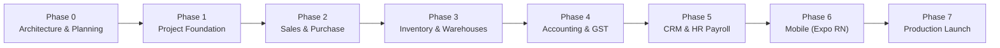

# BizFlow ERP — Comprehensive Development Roadmap

## 1. Development Lifecycle Overview

BizFlow ERP follows a structured 8-phase engineering roadmap designed for a solo developer using Antigravity Premium. Each phase must be fully validated, tested, and approved before commencing the next phase.

---

## 2. Phase-by-Phase Execution Plan

### PHASE 0: Architecture and Planning (Current Phase)
* **Goal**: Establish rock-solid architectural blueprints, domain models, database schema, API contracts, security models, and design system before writing functional code.
* **Deliverables**:
  1. `PROJECT_OVERVIEW.md`
  2. `SYSTEM_ARCHITECTURE.md`
  3. `DATABASE_DESIGN.md`
  4. `ENTITY_RELATIONSHIP_DIAGRAM.md`
  5. `API_DESIGN.md`
  6. `SECURITY_PLAN.md`
  7. `UI_UX_GUIDELINES.md`
  8. `DEVELOPMENT_ROADMAP.md`
  9. `TECHNOLOGY_DECISIONS.md`
  10. `PHASE_1_CHECKLIST.md`
  11. `ESTIMATED_COSTS.md`
  12. `DEVELOPMENT_STATUS.md`
* **Exit Criteria**: Developer review and formal sign-off on architecture documents.

---

### PHASE 1: Project Foundation & Core Infrastructure
* **Goal**: Establish the monorepo workspace, spin up local PostgreSQL and Redis containers, configure Prisma ORM, implement Argon2id authentication, multi-tenant organization switching, and the web shell with dashboard aggregates.
* **Deliverables**:
  - Turborepo & pnpm workspace initialization (`apps/web`, `apps/api`, `packages/shared-types`, `packages/validation`, `packages/shared-utils`).
  - Docker Compose for PostgreSQL 16, Redis 7, and MinIO.
  - NestJS modular API setup with global error handling, logging, and validation pipes.
  - Prisma migrations for Tenancy, IAM, Users, Roles, and Organizations.
  - Complete Authentication API: Register, Login, Refresh Token rotation, Logout, Password Reset.
  - Organization and Branch Management APIs (Create, List, Switch Context).
  - Next.js Web App: Landing, Login/Register forms, Dashboard layout, Persistent Topbar with Org Switcher, Active Branch Pill.
  - Executive Dashboard Shell connected to live database aggregate queries.
* **Exit Criteria**: A user can register, create a business organization, invite a team member, switch organizations, and view the dashboard shell with zero TypeScript or console errors.

---

### PHASE 2: Sales, Purchase & Billing Subsystems
* **Goal**: Deliver end-to-end commercial transactional workflows for sales and procurement with server-side numbering, PDF generation, and payment allocations.
* **Deliverables**:
  - Customer and Supplier Master directory management (GSTIN validation, state codes, addresses, credit limits).
  - Quotation / Proforma Invoice workflow with one-click conversion to Sales Invoice.
  - Sales Invoicing Engine: Draft creation, line-item tax calculations (CGST/SGST/IGST), server-side sequential numbering (`INV-YYYY-XXXXX`).
  - Invoice Finalization (`POST /sales/invoices/:id/post`) with transaction locks.
  - Supplier Purchase Order & Purchase Bill (GRN) workflow.
  - Payment Receipts and Supplier Payment Vouchers with multi-invoice allocation logic.
  - Credit Notes and Debit Notes for sales/purchase returns.
  - Server-side PDF invoice rendering engine with QR code generation.
* **Exit Criteria**: Full commercial cycle can be executed: Create Customer -> Issue Quotation -> Convert to Invoice -> Finalize Invoice -> Issue PDF -> Record Partial Payment -> Verify Outstanding Balance.

---

### PHASE 3: Inventory Management & Multi-Warehouse Operations
* **Goal**: Implement stock control, multi-warehouse allocations, barcode scanning, stock movements, and inventory valuation.
* **Deliverables**:
  - Product Catalog (Goods vs Services, HSN/SAC codes, UOMs, Barcodes, Categories).
  - Multi-Warehouse configuration per branch.
  - Automated Stock Ledger: Stock In on Purchase Bill Post, Stock Out on Sales Invoice Post.
  - Warehouse-to-Warehouse Stock Transfer slips.
  - Physical Stock Adjustment vouchers (shrinkage, damage, surplus).
  - Low-stock alerts and reorder level notification widgets on the dashboard.
  - Real-time stock valuation reports (Weighted Average Costing).
* **Exit Criteria**: Posting sales and purchase invoices updates stock levels accurately across warehouses; physical adjustments generate auditable stock movement logs.

---

### PHASE 4: Double-Entry Accounting & Indian GST Compliance
* **Goal**: Unify financial integrity with automated double-entry ledger posting, standard financial statements, and Indian GST filing preparations.
* **Deliverables**:
  - Standard Chart of Accounts (Assets, Liabilities, Equity, Revenue, Expenses) seeded on organization creation.
  - Automatic Journal Entry creation upon posting Sales Invoices, Purchase Bills, and Payment Vouchers.
  - Manual Journal Vouchers with strict validation (`Debit Total == Credit Total`).
  - General Ledger and Party Account Statements.
  - Real-time financial reports: Trial Balance, Profit & Loss Statement, Balance Sheet, Cash Flow.
  - Indian GST Engine: Automatic Place of Supply determination (Intra-state CGST+SGST vs Inter-state IGST).
  - GSTR-1 outward supplies export (B2B, B2CL, B2CS tables) and GSTR-3B monthly tax computation.
* **Exit Criteria**: Every invoice post creates a verified balanced journal entry; Trial Balance balances to zero; GST reports match tax line totals accurately.

---

### PHASE 5: Advanced ERP (CRM, HR & Payroll, Advanced Analytics)
* **Goal**: Extend platform capabilities to sales pipeline tracking, human resources, and business intelligence.
* **Deliverables**:
  - CRM: Lead capture, visual Kanban opportunity pipeline, follow-up scheduling, conversion to customer.
  - HR: Employee directory, department & designation hierarchies, daily attendance logging, leave approvals.
  - Payroll: Salary structure setup (Basic, HRA, Allowances, PF, ESI, TDS deductions), monthly payroll processing runs, automatic salary expense journal entries, PDF payslips.
  - Advanced Analytics: Customer aging analysis, product sales velocity, margin analysis, and Excel/CSV export engine.
* **Exit Criteria**: HR manager can run payroll and disburse payslips; CRM leads can convert to paying customers with complete audit trails.

---

### PHASE 6: Cross-Platform Mobile Applications (React Native + Expo)
* **Goal**: Develop and deploy high-performance Android and iOS apps with local SQLite storage and offline-first synchronization.
* **Deliverables**:
  - Expo Router app setup in `apps/mobile`.
  - Secure authentication via Expo SecureStore and biometric unlock.
  - Mobile Executive Dashboard with live KPI widgets.
  - Mobile Sales: Fast counter billing, customer lookup, thermal receipt printing via Bluetooth.
  - Mobile Inventory: Barcode camera scanning for stock lookup and physical counts.
  - Offline Engine: SQLite local store, outbox queue, background sync on network reconnection, conflict handling.
* **Exit Criteria**: Mobile user can create an invoice while in airplane mode; upon reconnecting, the invoice syncs to the server, receives a sequential number, and updates inventory.

---

### PHASE 7: Production Readiness, Security Auditing & Deployment
* **Goal**: Harden system security, optimize database queries, perform stress testing, configure CI/CD pipelines, and deploy to production infrastructure.
* **Deliverables**:
  - End-to-end automated testing suite (Jest backend tests, Playwright web E2E tests).
  - Rigorous financial precision tests (rounding edge cases, partial payment allocations).
  - Penetration testing & security audit (OWASP compliance, RLS verification, rate limit stress testing).
  - Production Docker setup with Nginx reverse proxy, SSL termination, and automated daily PostgreSQL backups.
  - Centralized monitoring, logging, and error tracking (Sentry + structured Winston logs).
  - Deployment runbooks, disaster recovery procedures, and user manual documentation.
* **Exit Criteria**: 100% test pass rate; zero critical security vulnerabilities; sub-100ms API response time at p95; successful disaster recovery restoration test.
