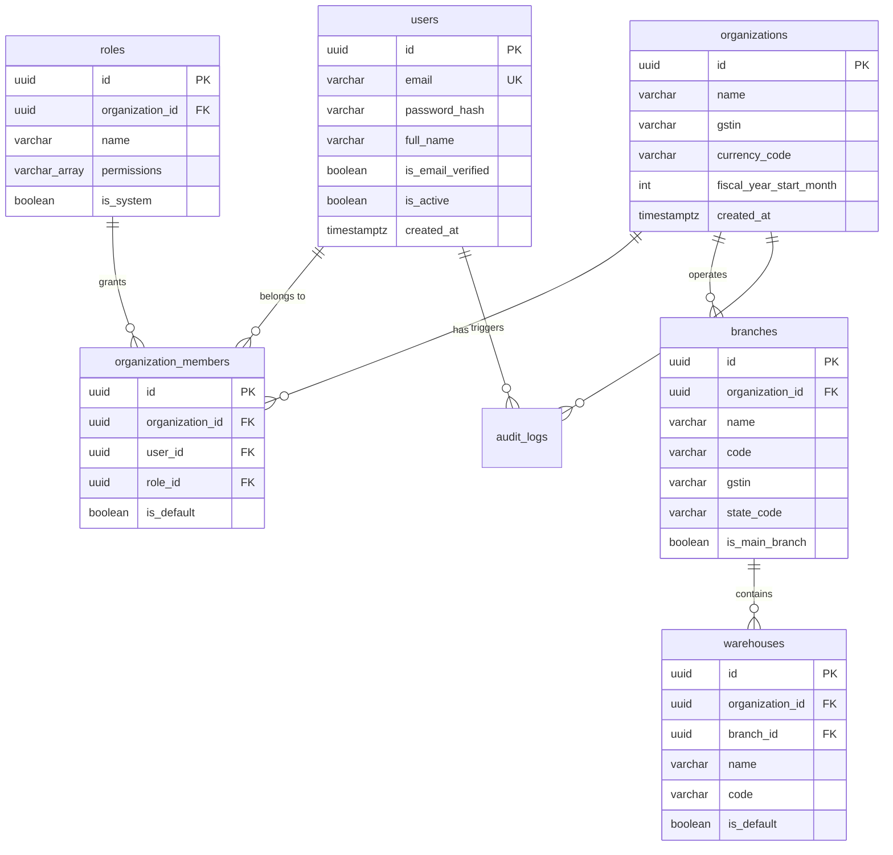
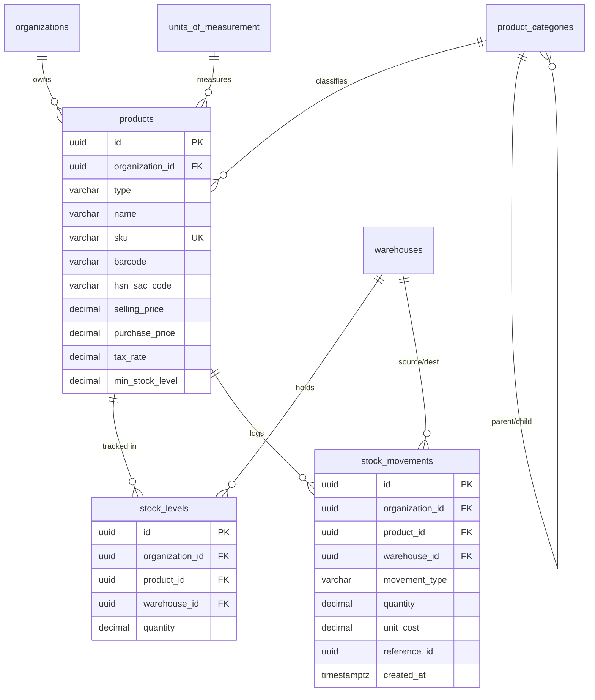
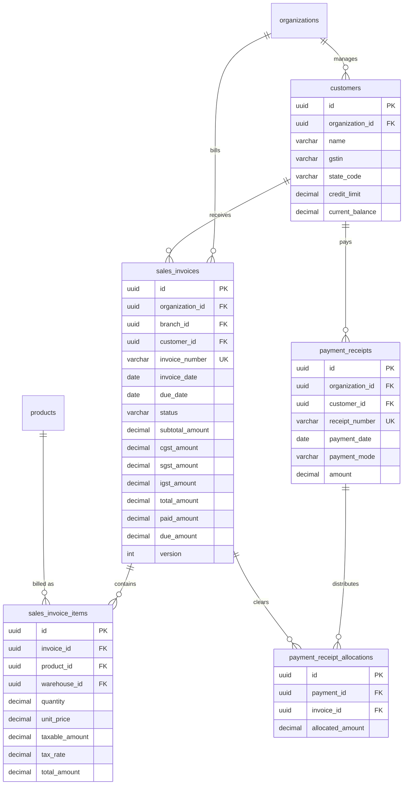
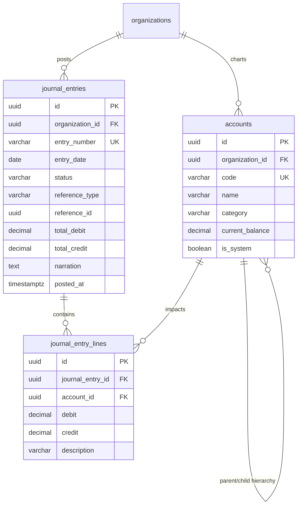
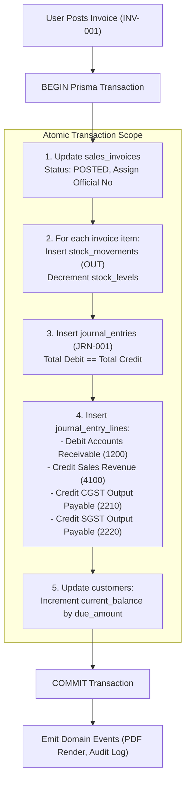

# BizFlow ERP — Entity Relationship Diagrams & Data Models

## 1. Tenancy, IAM, and Organization Model

---

## 2. Master Catalog & Multi-Warehouse Inventory

---

## 3. Sales, Invoicing, and Receivables

---

## 4. Double-Entry General Ledger Subsystem

---

## 5. Cross-Module Transactional Flow

The diagram below illustrates how a single business event (**Posting a Sales Invoice**) guarantees consistency across Sales, Inventory, and General Ledger via an atomic database transaction.

---

## 6. Referential Integrity & Cascade Rules Matrix

| Parent Table | Child Table | Foreign Key Column | On Delete Action | On Update Action | Architectural Rationale |
| :--- | :--- | :--- | :--- | :--- | :--- |
| `organizations` | `organization_members` | `organization_id` | `CASCADE` | `CASCADE` | Org deletion wipes all associated members. |
| `organizations` | `sales_invoices` | `organization_id` | `CASCADE` | `CASCADE` | Top-level tenant lifecycle boundary. |
| `customers` | `sales_invoices` | `customer_id` | `RESTRICT` | `CASCADE` | Cannot delete customer with posted invoices. |
| `sales_invoices` | `sales_invoice_items` | `invoice_id` | `CASCADE` | `CASCADE` | Deleting draft invoice purges its line items. |
| `products` | `sales_invoice_items` | `product_id` | `RESTRICT` | `CASCADE` | Cannot delete a product referenced in transactions. |
| `accounts` | `journal_entry_lines` | `account_id` | `RESTRICT` | `CASCADE` | Cannot delete an account with financial history. |
| `journal_entries` | `journal_entry_lines`| `journal_entry_id` | `RESTRICT` | `CASCADE` | Posted financial lines cannot be orphaned. |
| `warehouses` | `stock_levels` | `warehouse_id` | `RESTRICT` | `CASCADE` | Cannot delete warehouse with active stock. |
