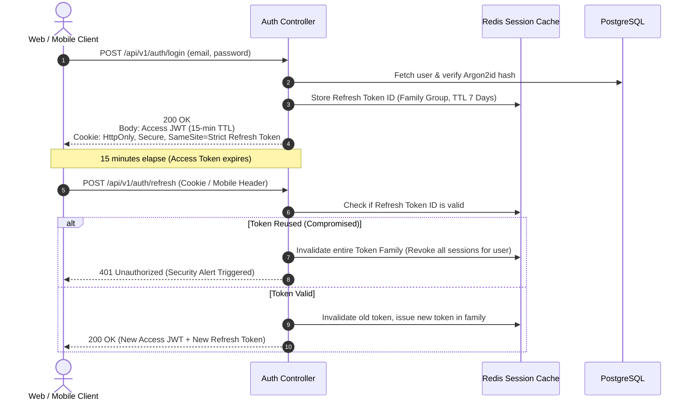

# BizFlow ERP — Security Architecture & Threat Mitigation Plan

## 1. Authentication & Session Security

### 1.1 Password Hashing with Argon2id
All user passwords must be hashed using **Argon2id** (the OWASP recommended standard that resists GPU cracking, side-channel attacks, and ASIC optimizations).
* **Algorithm**: `argon2id`
* **Memory Cost**: `65,536 KiB` (64 MB)
* **Time Cost (Iterations)**: `3`
* **Parallelism**: `4 threads`
* **Salt Length**: 16 bytes cryptographically random (`crypto.randomBytes(16)`)

### 1.2 Dual-Token Architecture & Rotation


* **Web**: Refresh token is stored in an `httpOnly`, `Secure`, `SameSite=Strict` cookie, completely inaccessible to JavaScript, neutralizing XSS token theft.
* **Mobile (React Native Expo)**: Stored in hardware-encrypted keystore via `expo-secure-store`.
* **Access JWT**: Stored only in memory (React state / TanStack Query cache), never in `localStorage` or `sessionStorage`.

---

## 2. Multi-Tenant Isolation Strategy (Defense-in-Depth)

BizFlow ERP protects multi-tenant data integrity across **three independent defensive layers**:

```
+-----------------------------------------------------------------------------------+
| LAYER 1: Ingress & TenantContextMiddleware                                        |
| - Inspects X-Organization-Id header                                               |
| - Queries organization_members to verify active membership                        |
| - Rejects request with 403 Forbidden before reaching controller                   |
+-----------------------------------------------------------------------------------+
                                      │
                                      ▼
+-----------------------------------------------------------------------------------+
| LAYER 2: Prisma ORM Tenant Extension                                              |
| - Automatic query rewrite on all tenant models                                    |
| - Injects `organizationId: context.tenantId` into WHERE clauses                   |
| - Eliminates human developer oversight in manual query writing                    |
+-----------------------------------------------------------------------------------+
                                      │
                                      ▼
+-----------------------------------------------------------------------------------+
| LAYER 3: PostgreSQL Row-Level Security (RLS)                                      |
| - DB-level policy: USING (organization_id = current_setting('app.current_org_id')) |
| - Rejects raw SQL leaks or accidental un-scoped queries at the database kernel    |
+-----------------------------------------------------------------------------------+
```

---

## 3. Financial Data Protection & Anti-Tamper Mechanisms

Financial software demands absolute trustworthiness. BizFlow ERP implements the following anti-tamper safeguards:

1. **Non-Destructive Financial Records**:
   - `DELETE` operations are completely forbidden on `sales_invoices` (once POSTED), `journal_entries`, `journal_entry_lines`, `stock_movements`, and `payment_receipts`.
   - Reversals must be executed via counter-entries (e.g., Credit Notes or Reversing Journals).
2. **Server-Authoritative Sequential Numbering**:
   - Document numbers (`INV-2026-00001`, `BILL-2026-00001`) are assigned atomically inside database transaction locks using dedicated PostgreSQL sequences or tenant sequence counter tables.
   - Prevents gaps, collisions, or client-fabricated invoice numbers.
3. **Idempotency Guard**:
   - Mutating endpoints require an `Idempotency-Key` header.
   - Checked against Redis/DB before execution. Network retries return the original committed response without re-executing accounting or inventory mutations.
4. **Append-Only Audit Trail with Hash Chaining**:
   - Every financial write logs to `audit_logs`.
   - Records store previous log hash `SHA-256(prev_hash + current_data)` to detect retroactive database tampering.

---

## 4. OWASP Top 10 Threat Modeling & Countermeasures

| Vulnerability | Threat Description in ERP | BizFlow Mitigation |
| :--- | :--- | :--- |
| **A01: Broken Access Control** | Tenant A attempts to view Tenant B's invoices by guessing UUIDs. | 3-layer Tenant Context + RBAC Guard on all endpoints. Direct object references without tenant match return `404 Not Found`. |
| **A02: Cryptographic Failures** | Storing plaintext passwords or exposing sensitive business bank accounts. | Argon2id for passwords; TLS 1.3 enforced in transit; sensitive tax keys encrypted at rest using AES-256-GCM. |
| **A03: Injection (SQL / Command)** | User enters SQL payload in search bar or customer name field. | Prisma ORM parameterizes 100% of queries. No dynamic string concatenation in raw SQL. |
| **A04: Insecure Design** | Submitting negative amounts on invoices to artificially manipulate receivables. | Zod validation schemas strictly enforce `min(0)` for amounts and positive integers for quantities. |
| **A05: Security Misconfiguration** | Verbose database stack traces returned to client. | Global NestJS `HttpExceptionFilter` sanitizes error responses. Detailed stack traces logged internally; user sees generic sanitized errors. |
| **A06: Vulnerable Components** | Third-party npm dependencies with vulnerabilities. | Automated GitHub Dependabot + `pnpm audit` in CI/CD pipeline. Strict zero-warning build gate. |
| **A07: Identification & Auth Failures** | Brute force password guessing. | Redis-backed sliding-window rate limiting on `/auth/login` (5 attempts per minute per IP, followed by progressive exponential lockouts). |
| **A08: Software & Data Integrity** | Corrupted offline synchronization payload silently overwriting server records. | Sync payloads validate entity `version` number. Idempotency guarantees single application of each operation. |
| **A09: Logging & Monitoring Failures** | Financial theft or unauthorized role changes going unnoticed. | Centralized structured JSON logging (Pino/Winston) with Winston-daily-rotate-file; audit logs track actor, IP, timestamp, and diff. |
| **A10: Server-Side Request Forgery** | Webhook or URL fetch features exploited to scan internal cloud network. | Strict whitelist validation for outbound URLs; internal RFC 1918 private IP addresses (10.0.0.0/8, 172.16.0.0/12, 192.168.0.0/16) blocked. |

---

## 5. File Upload Security (Invoice Attachments & Logos)

* **Direct Uploads via Presigned URLs**: Files are never streamed directly through the application server memory. The client requests a signed S3 upload URL with content-length and MIME-type restrictions.
* **MIME Sniffing & Extension Whitelist**: Allowed: `image/png`, `image/jpeg`, `image/webp`, `application/pdf`. Prohibited: `.exe`, `.sh`, `.svg` (prevents SVG stored XSS).
* **Storage Isolation**: User uploaded files reside in private buckets with no public read permissions. Read access is granted solely via 15-minute expiring presigned GET URLs.

---

## 6. Secrets Management Policy

* **Zero Hardcoded Secrets**: Secrets (JWT keys, DB credentials, Redis passwords) are never committed to version control.
* **Environment Configuration**: Loaded exclusively via `.env` files parsed by `@nestjs/config` and validated against a strict Zod schema on application startup. If a required secret is missing or malformed, the application refuses to boot.
* **Git Pre-commit Hooks**: Enforced via Husky to scan commits for accidental secret leakage (`detect-secrets`).
