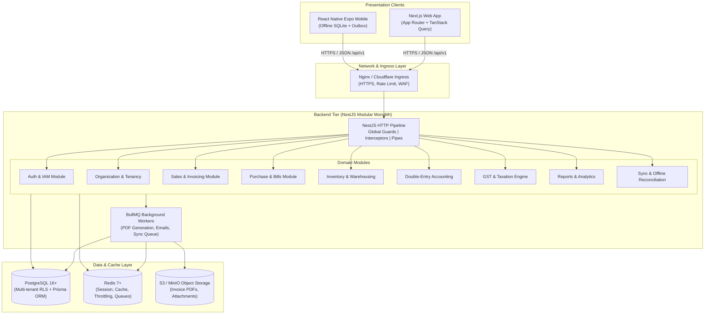
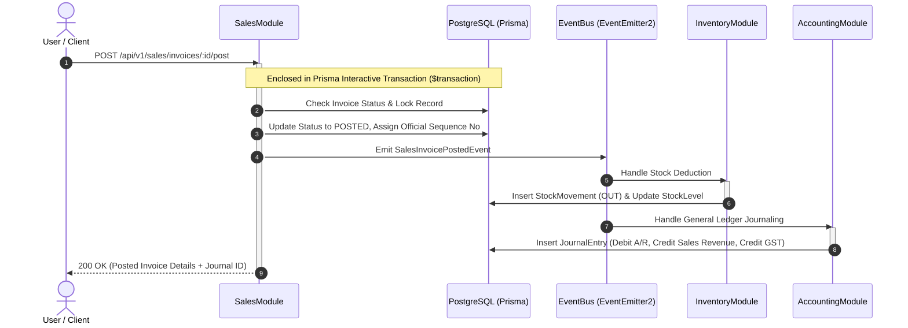
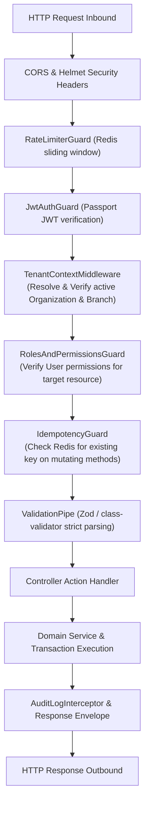
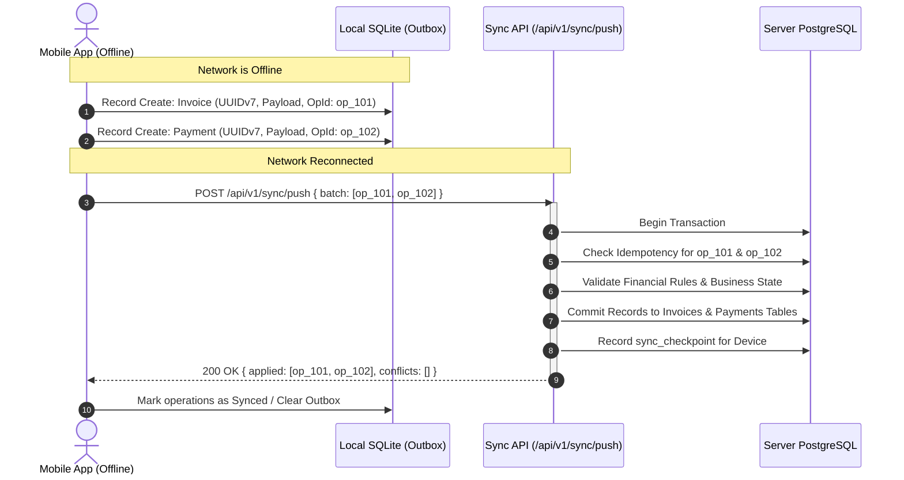

# BizFlow ERP — System Architecture

## 1. Monorepo Topology & Code Organization

BizFlow ERP is structured as a high-performance monorepo powered by **Turborepo** and **pnpm workspaces**. This layout enforces strict code reuse, guarantees type safety across boundaries, and allows independent versioning and deployment of frontend and backend applications.

```
bizflow-erp/
├── apps/
│   ├── web/                     # Next.js 15+ App Router, React, Tailwind CSS, TanStack Query
│   ├── api/                     # NestJS 10+ Modular Monolith REST API
│   └── mobile/                  # React Native + Expo Router (Phase 6)
│
├── packages/
│   ├── shared-types/            # Canonical TypeScript interfaces, enums, DTO contracts
│   ├── validation/              # Zod validation schemas shared between web, api, and mobile
│   ├── shared-utils/            # Financial math (decimal.js), date formatting, GST algorithms
│   ├── eslint-config/           # Unified linting rules
│   └── tsconfig/                # Unified TypeScript base configurations
│
├── database/
│   ├── prisma/                  # schema.prisma, migration history, seed scripts
│   └── docker/                  # Docker Compose for PostgreSQL, Redis, and MinIO
│
├── infrastructure/
│   ├── docker/                  # Production multi-stage Dockerfiles
│   ├── nginx/                   # Reverse proxy and SSL termination configurations
│   └── scripts/                 # Automated backup, restore, and CI verification scripts
│
├── docs/                        # Architectural documentation and runbooks
├── turbo.json                   # Turborepo task pipeline configuration
├── pnpm-workspace.yaml          # Monorepo package boundaries
├── package.json                 # Monorepo root scripts
└── README.md
```

---

## 2. High-Level Architecture Topology



---

## 3. Backend Architecture: NestJS Modular Monolith

BizFlow ERP deliberately chooses a **Modular Monolith** over microservices for its initial and growth phases. This prevents premature distributed systems complexity (network latency, distributed transaction orchestration, complex observability), while preserving clean domain boundaries that can be split into microservices if scaling demands dictate.

### 3.1 Domain Boundary Principles
* **Encapsulated Modules**: Each domain module (e.g., `SalesModule`, `InventoryModule`, `AccountingModule`) owns its controllers, services, repositories, and private DTOs.
* **Public Contracts**: Modules interact with other modules only through exported service interfaces or asynchronous domain events—never through direct cross-module database table joins or internal service manipulation.
* **Event-Driven Decoupling**: Mutating operations trigger internal Domain Events. For example, when `SalesInvoiceService.postInvoice()` executes, it raises a `SalesInvoicePostedEvent`. The `InventoryModule` consumes this to decrement warehouse stock, and the `AccountingModule` consumes this to create balanced double-entry journal vouchers.



---

## 4. Request Lifecycle & Interceptor Pipeline

Every inbound API request undergoes a deterministic pipeline:



1. **Helmet & CORS**: Enforce strict Content Security Policy, frame options, and whitelist allowed client origins.
2. **RateLimiterGuard**: Protect against brute-force and DoS using Redis sliding-window counters.
3. **JwtAuthGuard**: Decode short-lived access JWT; inject `user_id` into request context.
4. **TenantContextMiddleware**: Inspect `X-Organization-Id` header; verify that the user is an active member of that organization; attach `tenantId` to the execution context.
5. **RolesAndPermissionsGuard**: Validate granular capability flags (e.g., `sales.invoices.create`, `reports.financial.view`).
6. **IdempotencyGuard**: Inspect `Idempotency-Key` header for `POST`, `PUT`, and `PATCH` requests; return cached response if key was processed within 24 hours.
7. **ValidationPipe**: Strict schema enforcement, stripping unexpected properties and throwing RFC 7807 problem details on failure.
8. **AuditLogInterceptor**: Automatically record write actions to the immutable audit trail.

---

## 5. Storage & Asynchronous Processing Strategy

### 5.1 Redis & BullMQ
Redis functions in three dedicated roles:
* **Ephemeral Session & Token Revocation**: Managing active refresh token hashes and blacklist sets.
* **Distributed Rate Limiting**: Throttling public and authenticated endpoints.
* **BullMQ Task Queues**:
  - `pdf-generation`: Offloading headless Chrome/Puppeteer PDF rendering of invoices and payslips.
  - `email-queue`: Asynchronous dispatch of user invitation links, password reset tokens, and customer invoice notifications.
  - `sync-queue`: Batch processing of incoming offline synchronization outboxes.

### 5.2 S3-Compatible Object Storage
* **Development**: Local MinIO container with pre-seeded public and private buckets.
* **Production**: AWS S3 or Cloudflare R2 (zero egress fees).
* **Security Model**: Private buckets by default. Client downloads are authorized using time-limited presigned URLs (15-minute expiry).

---

## 6. Offline-First Synchronization Architecture

To support intermittent connectivity on mobile (and progressive web apps), BizFlow ERP incorporates an **Offline Outbox Synchronization Engine**.

### 6.1 Architectural Pillars for Offline Support
1. **Client-Side Canonical IDs**: Every record created offline is assigned a globally unique, time-sortable **UUIDv7** or **CUID2** on the client device. This allows relational references to be constructed offline before syncing with the backend.
2. **Outbox Pattern**: Offline mutations are written to a local SQLite/IndexedDB `outbox` table as an ordered queue of discrete operations.
3. **Version Vector / Revision Counter**: Every tenant entity has a `version` integer that increments on each update.
4. **Idempotent Sync Protocol**: When connectivity is restored, the client posts its outbox batch to `/api/v1/sync/push`. The server evaluates each operation inside a database transaction:
   - If the operation's `operation_id` was already processed, it is skipped safely.
   - If the server entity version matches the client's expected base version, the mutation applies and the entity version increments.
   - If the server entity version is higher (modified concurrently by another user), the server logs a **Conflict** into `sync_conflicts` and returns a reconciliation payload.

### 6.2 Conflict Resolution Strategy
* **Financial Transactions (Invoices, Payments, Journals)**: **Server-Authoritative / Reject Stale**. Invoices and payments must never be silently overwritten. If a document was cancelled or modified on the server while an offline edit occurred, the offline edit is rejected and flagged for manual resolution.
* **Master Records (Customers, Products)**: **Last-Write-Wins with Field-Level Reconciliation** or manual prompt in the mobile UI.


